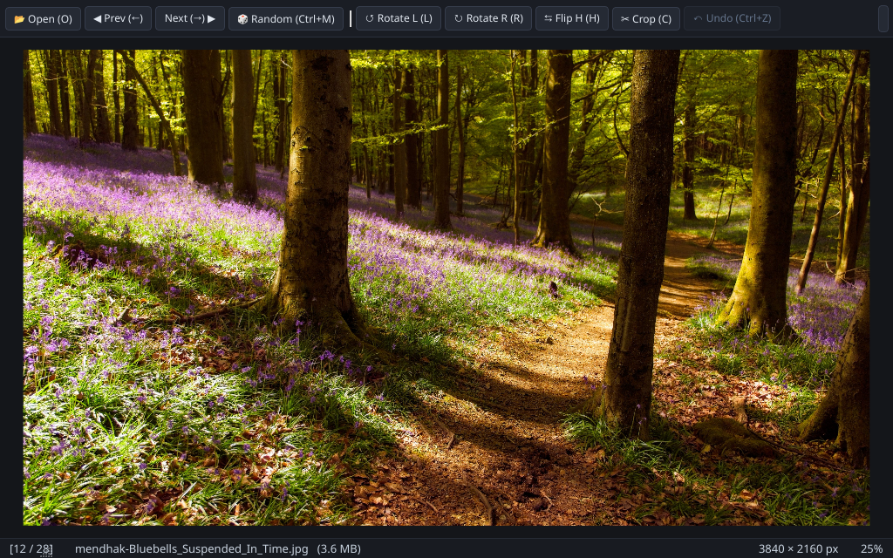

# HakuView 🦉

> **Fast, lightweight IrfanView-inspired image and video viewer for Ubuntu & Windows.**  
> Open any image from the middle of a folder, cycle with arrow keys, border-crop, rotate, compress, trim videos, and run slideshows without lag.

<p align="center">
  
</p>

---

## ⚡ 1-Liner Install

Install globally with desktop shortcuts and right-click **"Open with HakuView"** integration:

```bash
uv tool install git+https://github.com/hakanu/hakuview.git && hakuview --install-desktop
```

On Windows this adds HakuView, with its icon, to Explorer's right-click menu and to the **"Open with" / "How do you want to open this file?"** list. If you set it up with an older version and the icon is missing, run `hakuview --install-desktop` again.

> **Or run instantly without installing:**
> ```bash
> uvx --from git+https://github.com/hakanu/hakuview.git hakuview ~/Pictures
> ```

To update anytime:
```bash
hakuview --update
```

HakuView also checks GitHub for a newer release when it starts (at most every 12 hours) and offers a one-click update. Turn it off from the **⋯** menu → *Check for Updates on Startup*, or run *Check for Updates...* by hand.

---

## 📸 What It Does

- 📂 **Instant Folder Cycling (`←` / `→`)**  
  Open any single picture or video from anywhere in a directory. HakuView naturally orders sibling files and preloads neighbors in the background for zero-latency cycling.
- 🎲 **Random File Jump (`Ctrl+M`)**  
  Jump to a random photo or video in the folder, or launch directly with `hakuview --random ~/Pictures`.
- 🔎 **Go to File (`Ctrl+G`)**  
  Type a position number or part of a file name, pick with `↑` / `↓`, press `Enter`. Handy in folders with hundreds of files.
- 🕘 **Recent Folders**  
  The ⋯ menu lists the last 8 folders you opened (turn off with "Remember window size, position and recent folders" in Settings).
- ✂️ **Border Crop (`C`)**  
  Press `C` to reveal border handles on the image edges. Pull any side or corner inward and press `C` or `Enter` to crop. (Or simply left-drag a freehand box).
- 🔄 **Quick Rotate & Flip (`R` / `L` / `H` / `V`)**  
  Rotate 90° clockwise/counter-clockwise or flip horizontally/vertically on both images and videos (`<name>_rot90.mp4`, etc.).
- 🔇 **1-Click Lossless Audio Strip (`Edit ▾ → Strip Audio`)**  
  Instantly strip audio from any video (`<name>_muted.mp4`) using FFmpeg stream copy (`-c:v copy -an`) with zero video quality loss.
- 💾 **Non-Destructive & Safe**  
  Edits stay in memory with a 10-step undo (`Ctrl+Z`). Changes are only saved when you press `Ctrl+S` (atomic write) or `Ctrl+Shift+S` (Save As).
- 🗜️ **1-Click Image Compression (`K`)**  
  Click **Compress** or press `K` to save an optimized variant in the same directory (e.g. `image_lossless.png` or `image_lossless.webp`) with zero loss in quality.
- 🎬 **Videos & Slideshows in the Same Window (`W` / `F5`)**  
  Plays MP4, MKV, WebM, MOV, and animated GIFs without switching apps. During slideshows, videos play to completion before auto-advancing.
- ✂️ **Lossless Video Trimming (`[` / `]` or `I` / `O` + `T`)**  
  Scrub to any frame, press `[` (or `I`) to mark start, `]` (or `O`) to mark end, then press `T` or click **✂ Trim**. Uses instant FFmpeg stream copy with zero re-encoding and zero quality loss.
- 📱 **1-Click WhatsApp Web Video Export (`K` or `📱 WhatsApp`)**  
  Click **📱 WhatsApp** in the video bar (or press `K`) to export `<name>_whatsapp.mp4` with lowered H.264 + AAC bitrate (`yuv420p`, `+faststart`) guaranteed to stay under WhatsApp Web's limit.
- 📐 **CapCut-Style Video Reframe & Resize (`📐 Resize`)**  
  Convert vertical videos to landscape (16:9 1080p/720p, 9:16, 1:1, 4:5, 21:9, or custom W×H) with a live preview and automatic dominant-color Gaussian-blurred backdrop, living 4-corner ambient glow, solid dominant fill, or center crop.
- 🎨 **Color Scaling: Brightness & Contrast (`B`)**  
  Real-time brightness and contrast for images and videos. Save the result as a new image, a single video frame, or a whole new video (`<name>_color.mp4`) — originals are never overwritten.
- ℹ️ **Geeky Media Inspector (`I` / `Ctrl+I`)**  
  Opens a detailed technical card showing true compression ratios, video/audio bitrates, bits-per-pixel (BPP) efficiency, container profiles, and camera EXIF data with 1-click clipboard export.
- ⚙️ **Settings & Themes (`Ctrl+,`)**  
  Dark, Light or Follow-system theme, mouse wheel = zoom or next/previous file, sort by name / date / size, default compression preset and slideshow interval. Window size, position, recent folders and volume are remembered.

---

## ⌨️ Essential Shortcuts

| Key | Action |
| :--- | :--- |
| `←` / `→` | Previous / Next file in folder |
| `Ctrl + M` | Jump to a random file (also under `⋮` More Options) |
| `C` | **Border Crop** (drag borders inward, then press `C` or `Enter` to commit) |
| `B` | **Color Scaling** (Live brightness & contrast sliders for images and videos) |
| `R` / `L` | Rotate 90° Right / Left |
| `H` / `V` | Flip Horizontal / Vertical |
| `K` | **1-Click Compress** & save variant |
| `I` or `Ctrl + I` | **Media Inspector / Info Card** (Bitrate, Compression ratio, Codecs, EXIF) |
| `Ctrl + Z` | Undo last edit |
| `Ctrl + S` | Save changes (saves as new image if color scaling is active). Rotated/flipped JPEGs are saved losslessly when `jpegtran` is installed, otherwise at the original quality |
| `[ / I` and `] / O` | **Mark Video In / Out points** for trimming |
| `T` | **Export Trimmed Video** (Instant lossless stream copy) |
| `W` or `F5` | Toggle Slideshow (`[` and `]` change speed during photo view) |
| `F` or `Double-Click` | Fullscreen |
| `+` / `-` or `Wheel` | Zoom (centered at mouse); on video: playback speed. The wheel can step through files instead (Settings) |
| `,` / `.` | Video: step one frame back / forward |
| `Ctrl + C` / `Ctrl + Shift + C` | Copy image (or video frame) / copy file path |
| `F2` | Rename the current file |
| `Ctrl + G` | Go to file by number or name |
| `S` | Video: save the current frame as PNG next to the video (with brightness/contrast) |
| `Ctrl + ,` | Settings (theme, wheel, sorting, defaults) |
| `0` / `1` | Fit to window / 100% actual size |
| `Click Video` or `Space` | Play / Pause (stop) video |
| `Ctrl + W` / `Esc` | Close window / Exit fullscreen / Clear trim |

---

## 📦 Supported Formats

- **Images**: JPEG, PNG, WebP (static & animated), GIF, BMP, TIFF, SVG, ICO, AVIF, HEIC (HEIC needs the optional `pillow-heif`: `uv tool install --force --with pillow-heif git+https://github.com/hakanu/hakuview.git`)
- **Videos**: MP4, MKV, WebM, AVI, MOV, M4V, WMV, FLV, MPG, TS

---

## 🛠 Development

```bash
git clone https://github.com/hakanu/hakuview.git
cd hakuview
uv sync --extra dev
uv run pytest -v
```

---

## 👤 Author

- **Hakan Uysal** ([@hakanu_](https://x.com/hakanu_))
- GitHub: [hakanu/hakuview](https://github.com/hakanu/hakuview)

---

## 📄 License

[MIT](LICENSE) © 2026 Hakan Uysal
